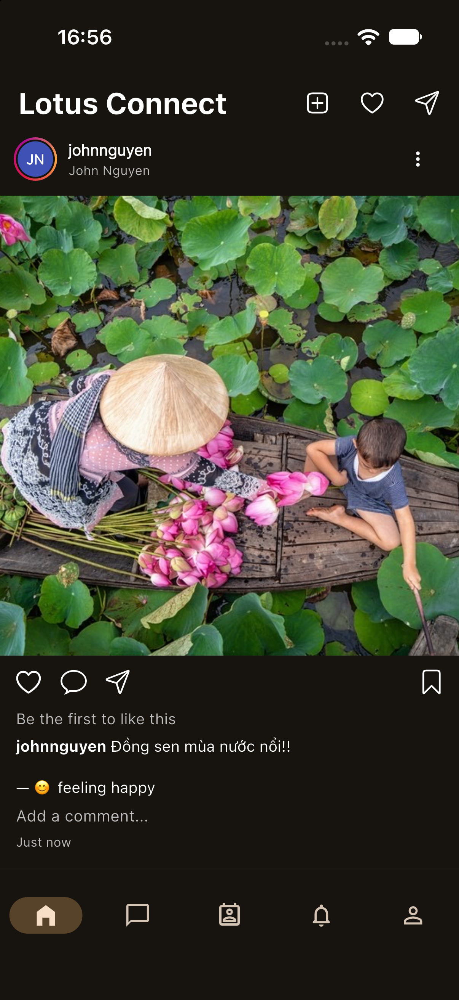
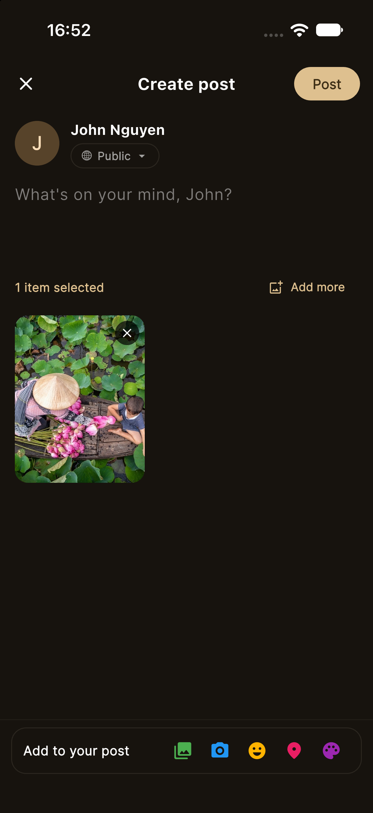
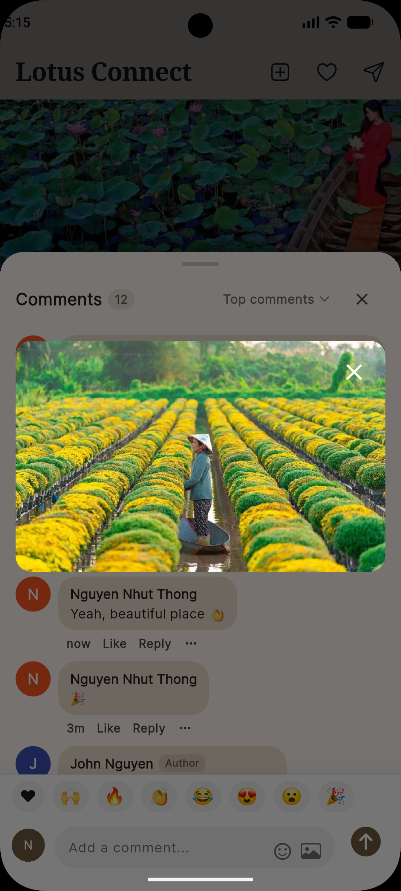
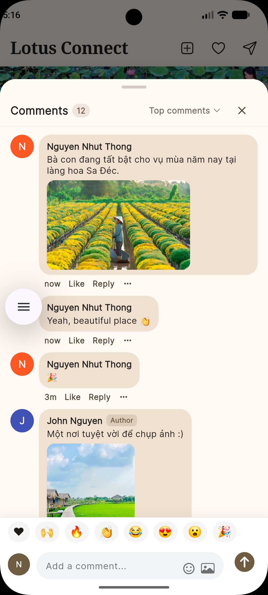
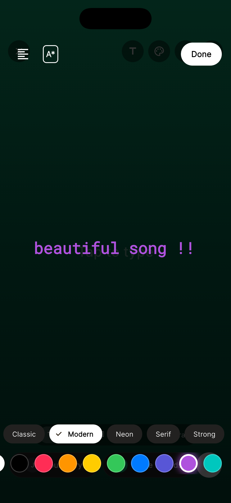
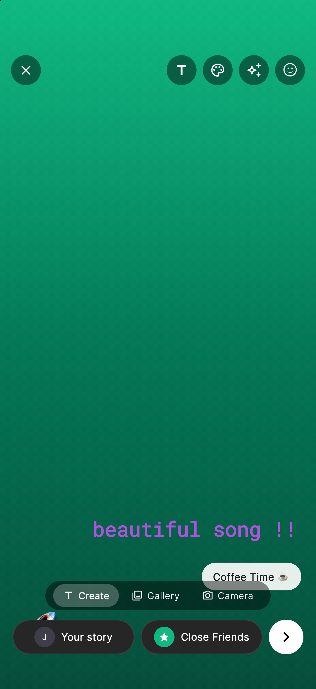
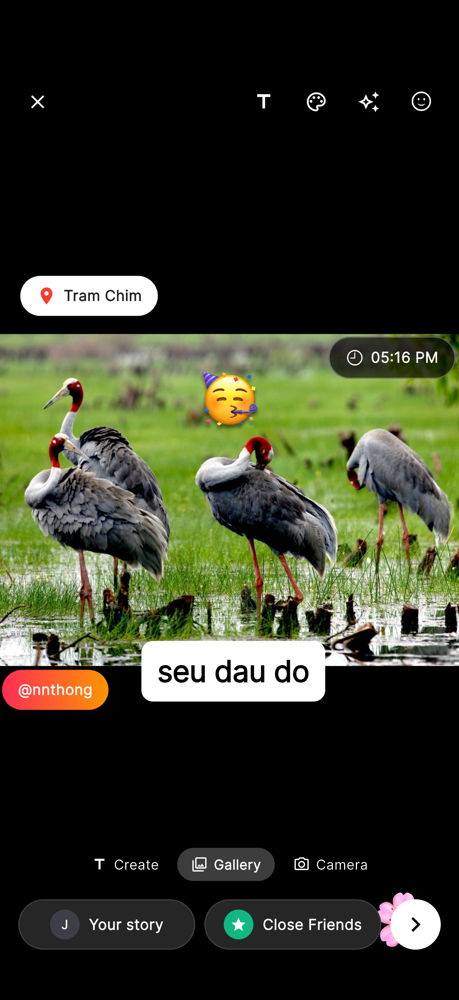
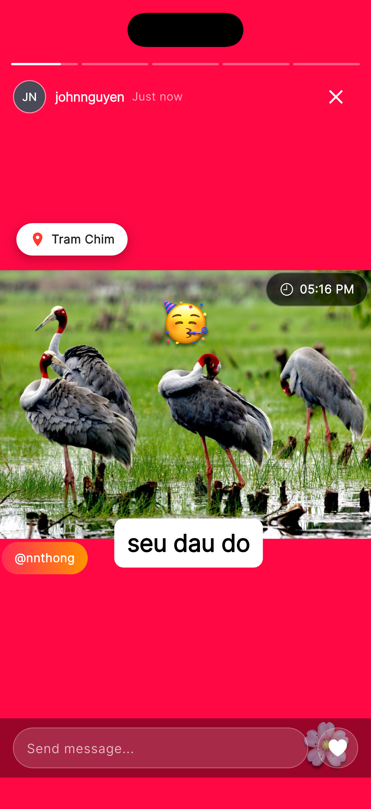
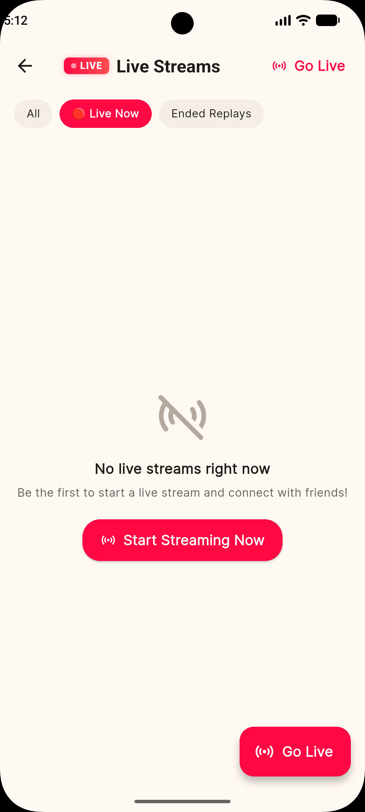
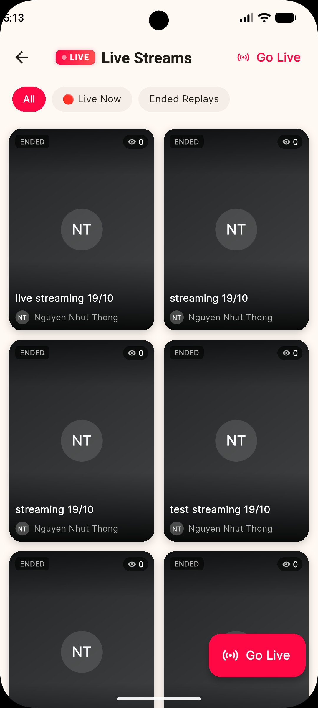

# Lotus Connect

A production-ready Flutter communication and social network platform built with **Clean Architecture**, reactive state management, real-time messaging, WebRTC calling, and Live streaming. The application is crafted with an **Instagram-style design**—aiming to replicate the core Instagram, Facebook and Tiktok demonstrate best practices in Flutter, reactive UI engineering, and Clean Architecture.

---

## 📱 Screenshots

| Home Feed | Create Post Screen |
|:---:|:---:|
|  |  |


| Comment Screen 1 | Comment Screen 2 |
|:-----------------------:|:-----------------------:|
|  |  |


| Create Story Screen 1 | Create Story Screen 2 | Create Story Screen 3 | Create Story Screen 4 |
|:-----------------------:|:-----------------------:|:-----------------------:|:-----------------------:|
|  |  |  |  |


|                        Live Stream Screen 1                        |                        Live Stream Screen 2                        |
|:------------------------------------------------------------------:|:------------------------------------------------------------------:|
|  |  |
---

## 🎬 Demos

### Person-to-Person (P2P) Chat
- **Video Link**: [P2P Chat Demo](https://devblocks.tech/wp-content/uploads/2026/08/chat-p2p.mov)

### Audio & Video Calling
- **Video Link**: [Video Call Demo](https://devblocks.tech/wp-content/uploads/2026/08/lotus_connect_video_call.mov)

---

## 🚀 Key Features

- **Instagram-Style Social Feed & Stories**: Rich interactive social feed replicating the Instagram experience with story rings, multi-photo/video carousels, inline video playback with thumbnail fallbacks, bursting double-tap heart reactions, and high-performance lazy loading via `ListView.builder`.
- **P2P Real-Time Chat**: Direct person-to-person messaging with message reactions, media sharing (images/videos), full-screen media viewer, and optimistic UI updates.
- **WebRTC Audio & Video Calling**: Real-time peer-to-peer voice and video calls powered by `flutter_webrtc`.
- **Native VoIP & Push Notifications**:
  - Full-screen incoming call UI using `flutter_callkit_incoming` (iOS CallKit & Android ConnectionService).
  - Background and foreground push notifications via Firebase Cloud Messaging (`firebase_messaging`) and `flutter_local_notifications`.
  - Custom ringtones and vibration feedback (`flutter_ringtone_player`).
- **Offline-First Storage**: Local database caching and indexing using Drift (SQLite).
- **Internationalization (i18n)**: Multi-language support (English, Vietnamese, Japanese, Chinese) via Flutter's `gen-l10n`.
- **Dynamic Theming**: Curated Light, Dark, and Sepia themes.

---

## 🛠️ Tech Stack

### Core & Framework
| Technology | Description |
| :--- | :--- |
| **[Flutter SDK](https://flutter.dev)** (Dart 3.5+) | Cross-platform UI toolkit targeting iOS, Android, macOS, Windows, Linux, and Web |
| **Clean Architecture** | Modular, feature-first structure strictly separating Domain, Data, Application, and Presentation layers |
| **[fpdart](https://pub.dev/packages/fpdart)** | Functional programming primitives (`Either`, `Option`, `TaskEither`) for robust, type-safe error handling without unhandled exceptions |

### State Management & Dependency Injection
| Library | Description |
| :--- | :--- |
| **[Riverpod](https://riverpod.dev)** (`flutter_riverpod`, `riverpod_annotation`) | Compile-safe, reactive state management and dependency injection |
| **`riverpod_generator`** | Code generation for type-safe and boilerplate-free providers and notifiers |

### Local Database & Persistence
| Library | Description |
| :--- | :--- |
| **[Drift](https://drift.simonbinder.eu/)** (`drift`, `drift_flutter`) | Reactive, type-safe SQLite database with migration strategies and stream queries |
| **`sqlite3_flutter_libs`** | Native SQLite libraries bundled for mobile and desktop platforms |
| **`path_provider`** | Cross-platform file system location access |

### Networking & Real-Time Communication
| Library | Description |
| :--- | :--- |
| **[Dio](https://pub.dev/packages/dio)** | Powerful HTTP client with interceptors, global configuration, and SSE (Server-Sent Events) chunk streaming |
| **[flutter_webrtc](https://pub.dev/packages/flutter_webrtc)** | Real-time WebRTC audio/video peer connection and media stream management |

### Calling, Notifications & Background Services
| Library | Description |
| :--- | :--- |
| **`flutter_callkit_incoming`** | Native incoming call screen integration for iOS (CallKit) and Android (ConnectionService / Telecom) |
| **`firebase_core` & `firebase_messaging`** | Firebase Cloud Messaging (FCM) for remote push notifications and data payloads |
| **`flutter_local_notifications`** | Foreground and local scheduled notifications |
| **`flutter_ringtone_player`** | Ringtones, alarms, and vibration control |

### Routing & Navigation
| Library | Description |
| :--- | :--- |
| **[GoRouter](https://pub.dev/packages/go_router)** | Declarative routing with nested shell navigation (`StatefulShellRoute`), deep-linking, and route guards |

### Media, Rendering & UI
| Library | Description |
| :--- | :--- |
| **`flutter_markdown` & `markdown`** | Rich markdown rendering for AI and chat responses |
| **`flutter_highlighter`** | Syntax highlighting for code blocks inside messages |
| **`cached_network_image`** | Smooth image loading, placeholder handling, and disk caching |
| **`video_player`** | Inline and full-screen video playback |
| **`image_picker`** | Photo and video selection from gallery or camera |
| **`google_fonts`** | Curated typography |

---

## 🧰 Development Tools & Code Quality

- **Code Generators**:
  - `build_runner`: Automated compilation runner for code generation.
  - `freezed` & `freezed_annotation`: Data classes, value equality, copyWith, and union states.
  - `json_serializable` & `json_annotation`: Automated JSON serialization/deserialization.
  - `drift_dev`: Drift schema, table, and database accessor code generator.
  - `flutter_launcher_icons`: Configuration-based app icon generation.
- **Linting & Analysis**:
  - `very_good_analysis`: Strict, enterprise-grade linting rules for high Dart code quality.
- **Testing & Mocking**:
  - `flutter_test`: Unit and widget test suite.
  - `mocktail`: Null-safe, ergonomic mocking for unit tests.
- **Logging**:
  - `logger`: Structured, readable console logging with log levels and stack traces.

---

## 🏁 Getting Started

### Prerequisites
- Flutter SDK `^3.5.0` or higher
- Dart SDK `^3.5.0` or higher
- Android Studio / Xcode (for mobile emulators/devices)

### Installation & Setup

1. **Clone the repository and install dependencies**:
   ```bash
   git clone <repository_url>
   cd lotus_connect
   flutter pub get
   ```

2. **Configure Environment Variables**:
   Copy the example environment file and customize your backend URL:
   ```bash
   cp .env.example .env
   # Edit .env to set your API_BASE_URL (e.g. ngrok tunnel or local backend)
   ```

3. **Generate code (Drift, Riverpod, Freezed, JSON serialization)**:
   ```bash
   dart run build_runner build --delete-conflicting-outputs
   ```

4. **Compile localization keys**:
   ```bash
   flutter gen-l10n
   ```

5. **Run static analysis**:
   ```bash
   flutter analyze
   ```

6. **Run test suite**:
   ```bash
   flutter test
   ```

7. **Launch the application**:
   ```bash
   # Using .env environment configuration:
   flutter run --dart-define-from-file=.env

   # Or fallback to default localhost:
   flutter run
   ```
